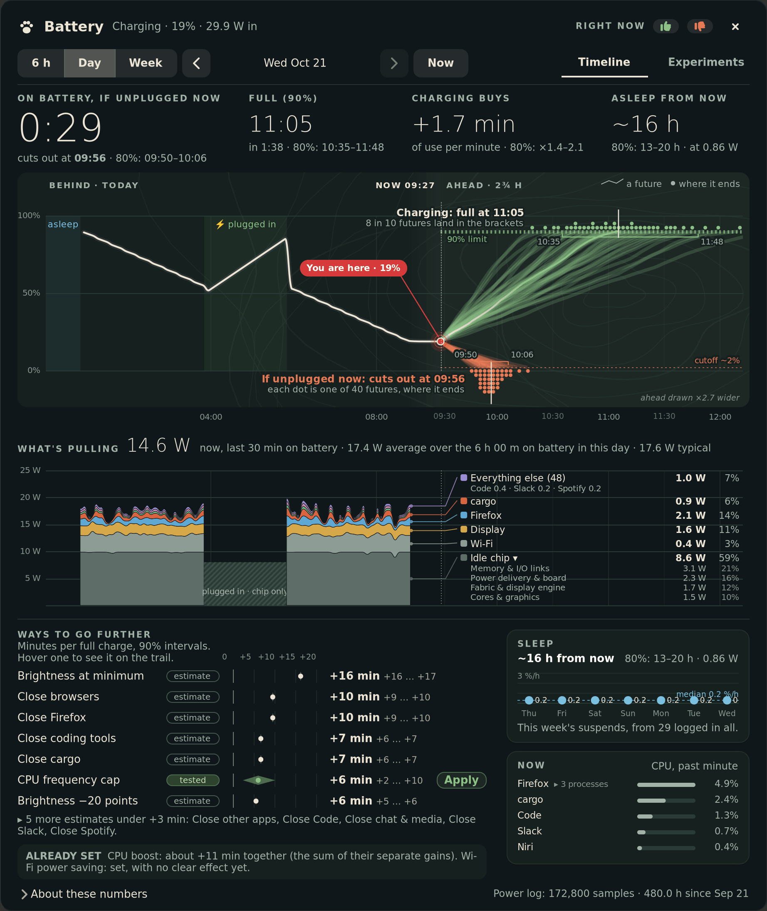
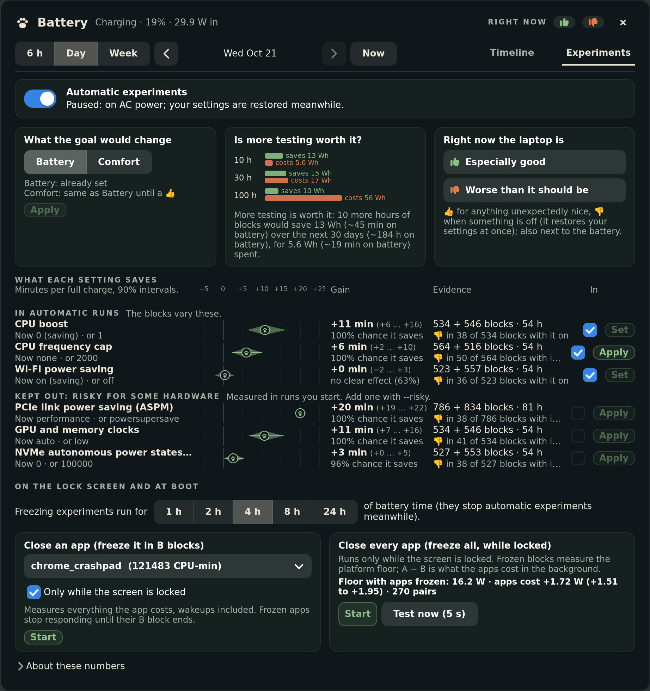

# drainhound

*A hound for battery drain on Linux laptops.*

drainhound measures where a Linux laptop's battery goes, forecasts how long it
will last, and finds out what would make it last longer **on your machine**:
it tries power settings in short randomized blocks while you use the laptop,
and fits what each one saves.

- **Battery use by app and by part**: every app's share of the draw (CPU time
  weighted by clock speed, GPU and video-engine time), the idle chip, the
  display, Wi-Fi, storage, and the rest, from a model fitted to your own
  measurements.
- **Time left that is right**: a forecast of your draw with an 80% interval
  (`1:17 ±0:15 14.2W`), how long a suspend would last, time to full while
  charging. It learns where your battery actually cuts out (often at 2%, not
  0%), counts down to it to the second, and can power off cleanly just before.
- **Experiments**: ASPM, NVMe APST, CPU boost, a frequency cap, the power
  profile, Wi-Fi power saving, panel power savings, GPU clocks, refresh rate,
  throttling background apps. Each 4-minute block on battery gets one
  combination, chosen where the model is least sure and the cost is low. A
  regression with a baseline per run and day separates their effects from what
  you were doing. It stops by itself once more testing would cost more battery
  than it could save.
- **Comfort, not just watts**: 👍 / 👎 buttons tell it when something is
  especially good or worse than it should be. 👎 restores your settings at
  once, and it learns which settings you notice.
- **Background apps**: throttle unfocused apps' CPU on battery, or freeze
  long-unused ones completely, the way Android does with cached apps.
- **A panel** that leads with the forecast: the battery level behind you runs
  into 40 sampled futures ahead, each ending in a dot where it lands, so a
  chance is something you can count. Under it, what is pulling now (labelled on
  the stack of watts), ways to go further (what-if estimates such as "close
  Firefox: +38 min per charge" and tested settings, on one axis), sleep drain,
  and the experiments as a forest plot. There's also a Waybar module, and a CLI
  for everything.





<sub>(Synthetic data from `tools/demo.py`.)</sub>

Everything stays on your machine: a SQLite database in `~/.local/state/drainhound`.
App names are coarse (no command lines, URLs or window titles).

> **Status**: young. It grew on one Framework Laptop 13 (Ryzen 7040) over two
> months of daily use. It has been made portable since (Intel and AMD, energy-
> or charge-reporting batteries, laptops without a chip power sensor), but has
> not yet run on many other machines. Reports welcome.

## Requirements

- Linux with systemd (user services, cgroup v2) and Python ≥ 3.14 with NumPy and SciPy.
- A laptop battery that the kernel exposes in `/sys/class/power_supply`.
- For the panel: GTK 4, libadwaita, PyGObject and, for a panel under your bar,
  gtk4-layer-shell (wlroots compositors, niri, KDE; elsewhere it opens as a
  normal window).
- For app throttling and freezing: a compositor drainhound can follow (niri or
  sway) and apps launched into their own systemd scopes (niri does this;
  under sway use a launcher that does, e.g. `app2unit` or `uwsm app`).
- Optional: `sudo`, for the root-only settings (see [the helper](#the-root-helper));
  power-profiles-daemon (or tuned-ppd) for the profile; `iw` for Wi-Fi power saving.

What gets measured depends on the hardware; see [docs/hardware.md](docs/hardware.md).

## Install

### NixOS (flake)

```nix
{
  inputs.drainhound.url = "github:zyansheep/drainhound";
  outputs = { nixpkgs, drainhound, ... }: {
    nixosConfigurations.laptop = nixpkgs.lib.nixosSystem {
      modules = [
        drainhound.nixosModules.default
        {
          services.drainhound = {
            enable = true;
            helper.users = [ "alice" ];   # may change root-only settings in experiments
            settings.battery.poweroff = true;
          };
        }
      ];
    };
  };
}
```

This installs the package and its user services (enabled for every graphical
session), the root helper with its sudo rule and suspend hooks, and
`/etc/drainhound/config.toml` from `settings`. Options: `helper.users`,
`helper.sleepHooks`, `panel.preload`, `readableRapl`, `settings`.

### Elsewhere

```sh
pipx install 'drainhound[panel]'        # or: pip install --user 'drainhound[panel]'
drainhound units --install              # writes ~/.config/systemd/user/drainhound-*, enables them
```

For root-only settings install the helper and give yourself a sudo rule for it
(run as yourself; `$USER` is you):

```sh
sudo install -m755 helper/drainhound-helper /usr/local/bin/drainhound-helper
echo "$USER ALL=(root) NOPASSWD: /usr/local/bin/drainhound-helper" | sudo tee /etc/sudoers.d/drainhound
sudo visudo -cf /etc/sudoers.d/drainhound
# Suspend hooks, so experiments never change link power management on the way into suspend:
printf '#!/bin/sh\ncase "$1" in pre) exec /usr/local/bin/drainhound-helper sleep-safe ;; post) exec /usr/local/bin/drainhound-helper sleep-restore ;; esac\n' \
  | sudo tee /usr/lib/systemd/system-sleep/drainhound && sudo chmod 755 /usr/lib/systemd/system-sleep/drainhound
```

Then set `helper.command = ["sudo", "-n", "/usr/local/bin/drainhound-helper"]` in
`~/.config/drainhound/config.toml`.

## Use

```sh
drainhound panel                 # the panel (toggle); `drainhound panel experiments` opens that tab
drainhound vote up | down        # 👍 especially good right now / 👎 worse than it should be
drainhound experiment enable     # automatic experiments while on battery (disable: puts back what they changed)
drainhound experiment status
drainhound experiment apply wifi-ps=saving cpu-cap=saving   # set a combination (until reboot, on battery)
drainhound check                 # gather every panel period from your data, timed
```

Give it a few hours on battery before the numbers mean much: the models fit
the last 30 days, and the first fits lean on priors.

### Waybar

[contrib/waybar](contrib/waybar) has the modules (time left, the two vote
buttons) and their style. With `drainhound-eta.service` running, the modules only
read what it publishes. A niri key for the panel is in
[contrib/niri/binds.kdl](contrib/niri/binds.kdl).

### Configuration

`~/.config/drainhound/config.toml` (and `/etc/drainhound/config.toml`), every key
optional; [contrib/config.example.toml](contrib/config.example.toml) explains
the common ones and `drainhound config` prints what is in effect. The usual ones
are:

- `battery.poweroff`: power off cleanly before the battery cuts out.
- `freeze.apps`: which apps to freeze when long unused.
- `stock.*`: what settings return to after experiments, if not as drainhound found them (`"found"`).
- `experiments.risky`: settings kept out of automatic runs.
- `apps.groups`: your timeline groups.

## The root helper

Most settings worth testing are root-only. `drainhound-helper` is a short bash
script with a fixed menu. Every command writes only the files it is about,
with validated values: there is no generic sysfs writer, and it never reads a
file you name. drainhound calls it through `sudo -n`, and it serializes changes
with a lock. Between its suspend hooks (`sleep-safe` before suspend,
`sleep-restore` after resume) every change is refused. On some machines ASPM
and NVMe power states are boot-time workarounds for crashes on the way into
suspend, so they are put back before every suspend. `helper/test-helper.sh`
tests it against a fake `/sys`.

Experiments treat ASPM, NVMe APST and GPU clocks as **risky**. They never run
automatically unless you add them (`drainhound experiment pool add aspm
--risky`). A watchdog reads the kernel log while experiments run. On a
hardware incident (a dead USB controller, a PCIe, GPU or NVMe error, a crash
while awake) it restores stock settings, quarantines what changed and turns
experiments off.

## How it works

[docs/how-it-works.md](docs/how-it-works.md) covers the models, the forecast,
the experiments and their safety. [docs/data.md](docs/data.md) covers the
database and the files other programs can read.

## Related tools

[PowerTOP](https://github.com/fenrus75/powertop) diagnoses wakeups and tunes
devices once. [TLP](https://linrunner.de/tlp/) and
[auto-cpufreq](https://github.com/AdnanHodzic/auto-cpufreq) apply fixed
policies. [Scaphandre](https://github.com/hubblo-org/scaphandre) and
[PowerJoular](https://github.com/joular/powerjoular) estimate per-process power
from RAPL. drainhound differs in two ways. It attributes the *battery's* draw,
display and devices included, from a model it fits to your own measurements.
And it decides policies by randomized experiment on your hardware and your
workload, instead of by rule.

## Development

```sh
nix develop                  # or any Python 3.14 with numpy, scipy (and PyGObject for the panel)
python -m unittest discover -s tests -t .
bash helper/test-helper.sh helper/drainhound-helper
nix flake check              # the tests, the helper's tests and shellcheck, the NixOS module
```

## License

MIT
